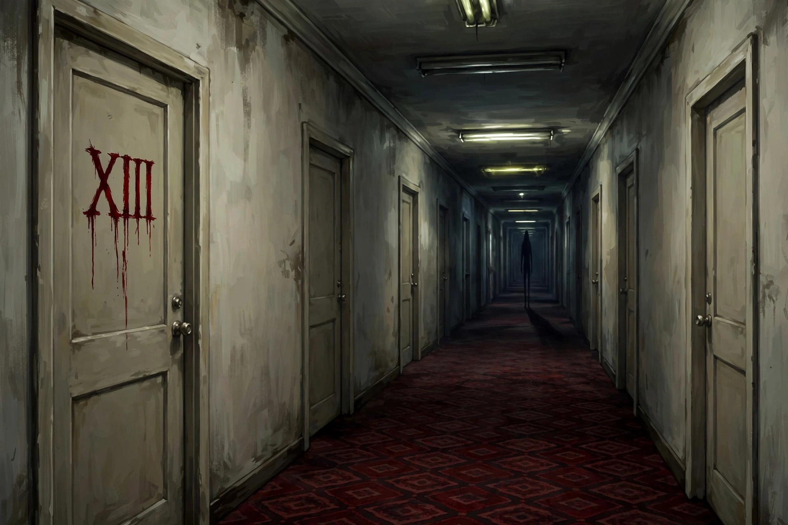
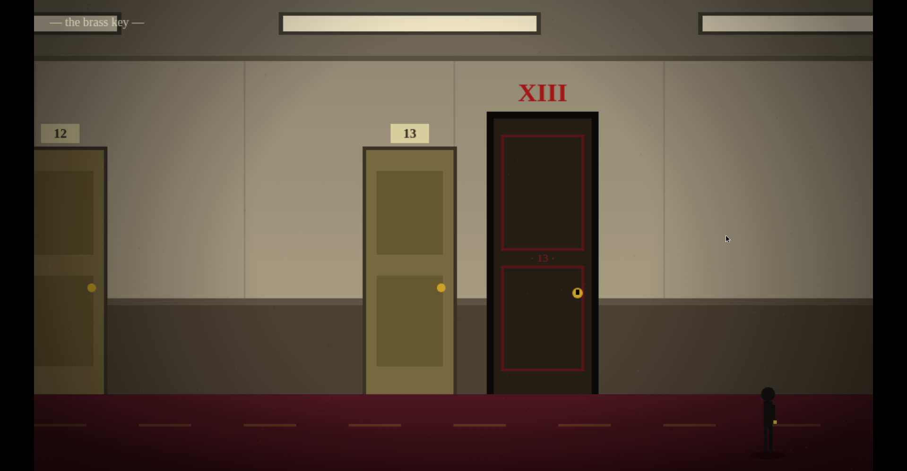
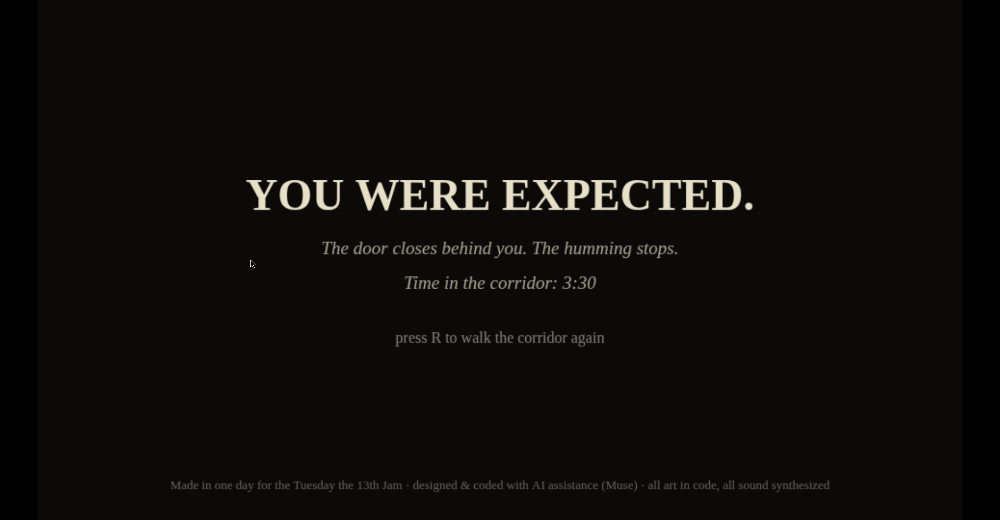

# UNLUCKY XIII

🏆 **Scored 5/5 across the board** in the Tuesday the 13th Jam host's playthrough video (our segment runs 7:16–10:15).

🕯️ **Play it now:** https://retroromrunner.github.io/unlucky-xiii/
Also on itch.io — https://retroromrunner.itch.io/unlucky-xiii — where it was made for the Tuesday the 13th Jam.

A liminal horror micro-game. You are alone in an endless hotel corridor, humming with fluorescent light. Somewhere down the carpet is a brass key — and somewhere past it, **Door XIII**.

Something tall is standing in the corridor with you. It cannot move while the lights are on. The lights do not stay on — and no two blackouts last the same length. In the dark, it hunts: keep ahead of it until the lights come back, and if it is close when they do, it dissolves. Let it reach you in the dark and you are UNLUCKY.

## How to play

- **← → or A / D** — walk
- Find the brass key, then reach Door XIII
- **R** — restart after an ending
- Sound on, if you dare — the humming tells you more than your eyes

## Scoring

- **+25** for every door you pass
- **+50** for walking past it in the light
- **+100** for surviving its hunt in the dark
- **+500** for opening Door XIII

## About

A single self-contained HTML file — every sprite drawn in code, every sound synthesized live with Web Audio: the fluorescent hum, your footsteps, your heartbeat. Made in one day for the [Tuesday the 13th Jam](https://itch.io/jam/tuesday-the-13th-jam). Designed and coded with AI assistance (Muse); the cover art is AI-generated; all in-game art is drawn in code and all sound is synthesized live.
